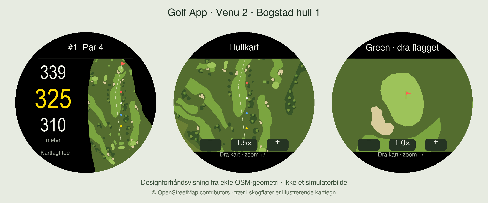

# Garmin Golf — Venu 2 prototype

A personal, AI-assisted Connect IQ golf app written in Monkey C, with a Python pipeline for OpenStreetMap course geometry. It includes map navigation, front/target/back distances, scorekeeping, club selection and a persistent GPS shot log for Bogstad and Bærum.

**Status:** prototype. Simulator and physical-watch runtime behaviour remain unverified. Preview images below are design renders, not device screenshots. Requires an existing Garmin Connect IQ SDK, Java, Python 3 and OpenSSL to build. See the Norwegian instructions below.



## Verification — 30 October 2026

`python3 scripts/check_data.py`: all 9 checks passed. Watch/simulator tests were not run in this publication pass.

## Public snapshot

Includes source, tests, generated resources and attributed public map data. Excludes signing keys, build outputs and copies of Garmin documentation. Data and derived course databases are © OpenStreetMap contributors, under [ODbL 1.0](https://www.openstreetmap.org/copyright); see [data provenance](docs/course-data.md). No additional licence is granted for the application source. This is an independent hobby prototype.

## Norwegian documentation

Byggbar Connect IQ-prototype med S72-inspirert skjerm og åpne banedata for **Bogstad og Bærum**. Dette er ikke en komplett kopi eller port av Garmin-programvaren. Original S72-app/fastvare er ikke funnet; ingen REA-analyse av originalen er utført.

Se [kartvisningen](docs/ui-preview.png), [meny og slagregistrering](docs/shot-preview.png), [slagflyten](docs/shot-workflow.md), [plan og full funksjonsstatus](docs/plan.md), [S72-referansen](docs/s72-reference.md) og [datagrunnlaget](docs/course-data.md). Bildene er designforhåndsvisninger, ikke skjermbilder fra simulator eller klokke.

## Bygg

Krever et eksisterende Garmin Connect IQ SDK, Java, Python 3 og OpenSSL. På denne Mac-en finnes SDK-et allerede. Skriptet leser `current-sdk.cfg`; sett `GARMIN_SDK` for å velge et annet SDK. Skriptet installerer ingenting. Det genererer en separat lokal utviklernøkkel i den ignorerte `build/`-mappen hvis den ikke finnes.

```sh
python3 scripts/generate_courses.py
python3 scripts/check_data.py
python3 scripts/build.py
```

Resultat: `build/GolfApp.prg`, mål `venu2`. Minste deklarerte API er 4.0. SDK-et er 9.1.0 i denne verifikasjonen. Bygg bruker SDK-ets gradvise typekontrollnivå 1. Det finnes fortsatt advarsler om dynamiske containerverdier; kompilering bekrefter ikke runtime-oppførsel.

Monkey C-tester må kjøres i en **allerede startet** Garmin-simulator:

```sh
python3 scripts/build.py --tests --run
```

De 31 Monkey C-testene i `tests/` dekker geometri, handicap, slagidentitet, køllevalg, eldre lagringsformat, gjenopptakelse og feil under lagring/arkivering/opprydding. De bruker en separat testkonfigurasjon og en minnelagring som ikke skriver til klokkens appdata. I denne leveransen er testprogrammet kompilert, men testene er ikke kjørt: datamaskinverktøyet avviste tilgang til simulatoren. Se [verifikasjon](docs/verification.md).

## Prøv på egen klokke

1. Koble Venu 2 til Mac-en med datakabel. Kontroller at det er vanlig **Venu 2**, ikke 2S/2 Plus.
2. Etter at klokken er tilgjengelig i filoverføring, legg `build/GolfApp.prg` i klokkens `GARMIN/APPS`-mappe. Dette er en vanlig Connect IQ-app, ikke en fastvareoppdatering.
3. Løs ut klokken og åpne **Golf App** i aktivitets-/applisten.

Klokken var ikke tilgjengelig for overføring i denne sesjonen. Skjerm, GPS, strømforbruk og lagring må testes fysisk. Rå OSM-geometri er ikke feltverifisert og kan være utdatert. Målverdien er kartlagt endepunkt, ikke dagens flagg. Ikke legg inn S72-fastvare på Venu 2.

## Bruk

- Velg Bogstad eller Bærum fra menyen. Appen venter på en fersk GPS-posisjon før den viser aktuelle avstander.
- Hovedvisningen viser bakkant øverst, mål i gult og forkant nederst. Trykk på kartet for målpunkt; dra kartet for panorering og bruk **+ / −** for zoom fra 1× til 8×. Midtknappen sentrerer og nullstiller zoom. Åpne **Green** for å trykke eller dra flagget innenfor kartlagt green. Dra et annet sted for å panorere greenkartet. Ingen pinch-hendelse ble funnet i det undersøkte Venu 2-API-et.
- Sveip venstre/høyre for hullbytte, opp/ned for scorekort. I scorekortet reduserer venstre side og øker høyre side verdien på raden.
- **Slag totalt** inkluderer putter og straff; de legges ikke til en gang til. Spillhandicap er antallet mottatte slag for denne runden, ikke din handicapindeks.
- Registrer egen carry under **Mine køller**. Ingen standardlengder er diktet opp. Kølleforslag bruker bare mål-avstand og denne lengden.
- Åpne **Mål slag**, velg **Start nytt slag**, og velg køllen du skal slå med. Avslutt målingen ved neste ballposisjon. Avstanden er GPS-avstand mellom posisjonene, inkludert eventuell rull, og er ikke carry.
- En måling beholder opprinnelig hull, kølle og startpunkt gjennom hullbytte og app-exit. Du kan bytte kølle for målingen eller avbryte den eksplisitt. En måling må fullføres eller avbrytes før runden arkiveres.
- **Slaghistorikk** gir registreringer per hull eller for hele runden. Åpne et slag for å korrigere køllen eller slette det med bekreftelse. Du kan også legge til glemte slag og putter; da er avstanden ukjent.
- Slagloggen endrer ikke score, putter eller straff i scorekortet. Dette hindrer dobbelttelling. **Køllestatistikk** viser antall registreringer og snitt/lengste GPS-avstand for runden; egen carry beholdes separat.
- Baggen har 14 forhåndsdefinerte køllevalg, inkludert putter og wedger, samt **Ukjent kølle**. Ingen kølle velges automatisk ved første måling. Eksisterende lengder fra den eldre baggen med ti køller beholdes.
- **Avslutt runde** tilbyr lagring eller eksplisitt forkasting. En aktiv runde beholdes når appen lukkes. Inntil ti runder vises lokalt i historikken; lagrede slag kan åpnes for visning. Hver ny arkivert runde har sin egen lagrede verdi for å unngå å samle alle slag i én verdi over SDK-ets grense på 32 KB. Mislykket opprydding beholdes for nytt forsøk.

## Data og videre arbeid

`python3 scripts/acquire_courses.py` regenererer fra beholdte råfiler. `--download` henter nye OSM-snapshots. Baner må valideres på nytt etter oppdatering; opprett gjerne en kopi av `data/` før oppfriskning. Losby er utelatt på grunn av midlertidig ruting i 2026.

Data: **© OpenStreetMap contributors**, [ODbL 1.0](https://www.openstreetmap.org/copyright). Kildelenker, råfiler, SHA-256, usikre indekser og kildegeometri følger i `data/` og `docs/`. Det avledede datasettet følger ODbL. Kartressurser lastes ett hull om gangen. Bakgrunnskartet mellomlagres i ett bilde på opptil 229632 pikselbytes pluss objekt-/grafikkoverhead ved 16 bit per piksel. Hver panorering/zoom tegner bufferen på nytt; faktisk minnebruk, ytelse og batteri må måles på klokken.

Farger ligger i `data/map-style.json`, som genererer både klokkens palett og brukes i designforhåndsvisningen. Baneflater og individuelle kartlagte trær kommer fra OSM. Trekroner inne i skogpolygoner er illustrerende karttegn; de hevdes ikke å være innmålte enkelttrær. Bare komplette, lukkede flateveier og kartlagte trepunkter tegnes; sammensatte OSM-relasjoner er foreløpig utelatt. Sensorverdier, greenhellinger, flyfoto eller Garmin-integrasjoner simuleres ikke som ekte funksjoner.
